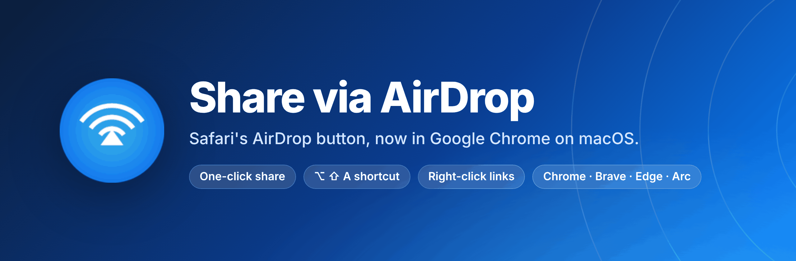
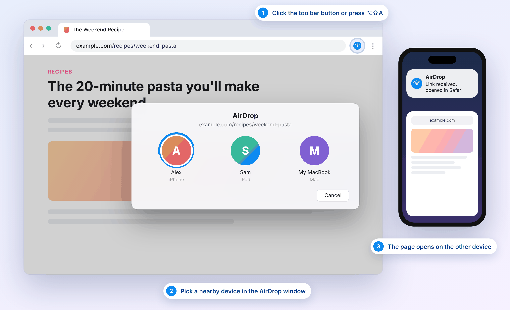
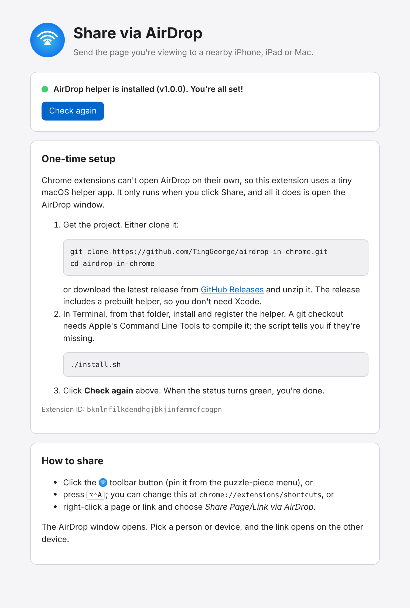
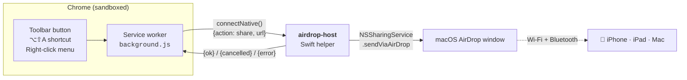
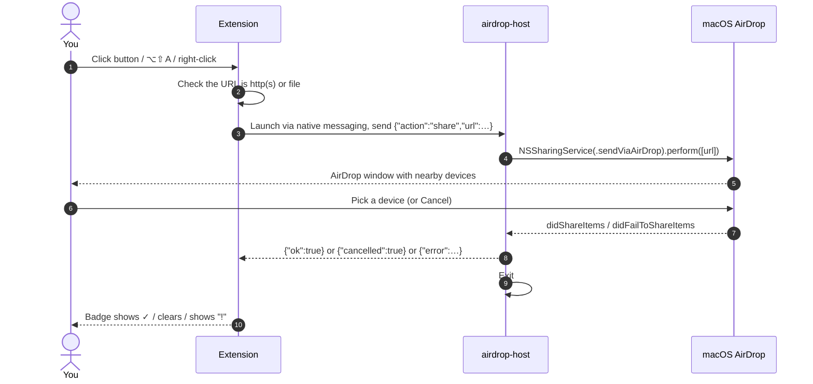

<p align="center">
  
</p>

<p align="center">
  <a href="https://github.com/TingGeorge/airdrop-in-chrome/releases/latest"></a>
  <a href="https://github.com/TingGeorge/airdrop-in-chrome/actions/workflows/release.yml"></a>
  
  
  
</p>

<p align="center">
  <b>Safari can AirDrop the page you're reading to your iPhone in two clicks. Chrome can't.</b><br>
  This extension adds that missing button to Chrome, Brave, Edge, Arc and other Chromium browsers on the Mac.
</p>

<p align="center">
  <a href="#-install"><b>Install</b></a> ·
  <a href="#-how-it-works"><b>How it works</b></a> ·
  <a href="#-troubleshooting"><b>Troubleshooting</b></a> ·
  <a href="#-development"><b>Development</b></a>
</p>

---

<p align="center">
  
</p>
<p align="center"><sub>Illustration of the sharing flow. The AirDrop window you see is the real macOS one.</sub></p>

## ✨ Features

| | |
| --- | --- |
| 🖱️ **One-click sharing** | Click the toolbar button to AirDrop the current tab, like Safari's Share → AirDrop. |
| ⌨️ **Keyboard shortcut** | <kbd>⌥ Option</kbd> + <kbd>⇧ Shift</kbd> + <kbd>A</kbd>. You can change it at `chrome://extensions/shortcuts`. |
| 🔗 **Right-click menu** | *Share Page*, *Share Link* (any link, without opening it) and *Share Media Address* (images, video, audio). |
| 📄 **Local files** | A PDF or other file open in Chrome (`file://…`) is sent as the file itself, not as a link. |
| ✅ **Clear feedback** | The toolbar badge shows `…` while AirDrop is open, ✓ when the page is sent, and `!` with the reason when something goes wrong. |
| 🧩 **Works across browsers** | Google Chrome (Stable/Beta/Dev/Canary), Chromium, Brave, Microsoft Edge, Vivaldi and Arc. |
| 🔒 **Private by design** | No network access, no analytics, no tab-reading permission. The extension only sees a URL when you click Share. |

## 🚀 Install

There are two parts: the **extension**, and a small **AirDrop helper** that the extension asks to open the AirDrop window. Setup takes about a minute.

### Option A: Download a release (recommended, no Xcode needed)

1. Download **`airdrop-in-chrome-vX.Y.Z.zip`** from the [latest release](https://github.com/TingGeorge/airdrop-in-chrome/releases/latest) and unzip it.
2. Open **Terminal**, `cd` into the unzipped `airdrop-in-chrome` folder and run:
   ```sh
   ./install.sh
   ```
   This copies the prebuilt helper (a universal binary for Apple silicon and Intel) and registers it with your browsers.
3. Load the extension:
   1. Open `chrome://extensions`.
   2. Turn on **Developer mode** (top right).
   3. Click **Load unpacked** and choose the `extension` folder.
4. Pin **Share via AirDrop** from the 🧩 puzzle-piece menu so the button stays in the toolbar.

### Option B: Build from source

You need Apple's Command Line Tools (`xcode-select --install`).

```sh
git clone https://github.com/TingGeorge/airdrop-in-chrome.git
cd airdrop-in-chrome
./install.sh            # compiles native-host/AirDropHost.swift and registers it
```

Then load the `extension` folder as in step 3 above.

### Check that it works

A setup page opens automatically when the extension is installed. You can also reach it from the extension's **Options**. A green dot means everything is connected.

<p align="center">
  
</p>

## 🧠 How it works

Browser extensions run in a sandbox and can't call macOS APIs, so JavaScript alone can't reach AirDrop. The extension uses Chrome's [native messaging](https://developer.chrome.com/docs/extensions/develop/concepts/native-messaging) to start a tiny Swift helper. The helper asks macOS for the same AirDrop window Safari uses.





- **The helper runs only while you share.** Chrome starts it for one request. It has no Dock icon or menu bar, and it exits as soon as the AirDrop window closes, or after 10 minutes if the window is left open.
- **The extension stays alive while you choose.** It talks to the helper over a native messaging *port*, which keeps the service worker running even if you take a while to pick a device.
- **The extension ID is fixed.** `manifest.json` contains a public `key`, so the unpacked extension always gets the ID `bknlnfilkdendhgjbkjinfammcfcpgpn`. The installer only lets that ID talk to the helper.

### What gets installed where

| Path | What |
| --- | --- |
| `~/Library/Application Support/AirDropForChrome/airdrop-host` | The helper executable |
| `~/Library/Application Support/<Browser>/NativeMessagingHosts/com.tinggeorge.airdrop_for_chrome.json` | Tells each browser where the helper is and which extension may use it |

Nothing is installed system-wide and `sudo` is never needed.

## 🛡️ Privacy & security

- **Minimal permissions.** The extension asks for `activeTab`, `contextMenus` and `nativeMessaging`. It can't read your tabs or browsing history; Chrome only gives it the current tab's URL at the moment you click Share.
- **Nothing leaves your Mac except the AirDrop itself.** The helper makes no network connections, and neither part collects analytics.
- **Locked to this extension.** The helper's manifest only allows this extension's ID, so other extensions can't use it.
- **Small enough to read.** The helper is [about 150 lines of Swift](native-host/AirDropHost.swift).
- **About the quarantine flag.** Release downloads are ad-hoc signed but not notarized. When you install from a release, `install.sh` removes the macOS quarantine flag from the helper only, so Chrome is allowed to launch it. If you'd rather not, use [Option B](#option-b-build-from-source) and build it yourself.

## 🩺 Troubleshooting

| Symptom | Fix |
| --- | --- |
| Setup page says **"isn't installed yet"** | Run `./install.sh`. If it still fails, quit Chrome completely (⌘Q) and reopen it. |
| Setup page says **"not for this extension ID"** | You loaded the extension under a different ID (for example from a store). Run `./install.sh --extension-id <ID shown on the setup page>`. |
| **"AirDrop can't share this right now"** | Turn on Wi-Fi and Bluetooth, and set AirDrop to *Contacts Only* or *Everyone* in Control Center. |
| The AirDrop window opens **behind** Chrome | Newer macOS versions sometimes refuse to bring the window forward. Switch to it with ⌘Tab or Mission Control. |
| Badge shows **✕** | This page can't be shared. Only `http`, `https` and `file` URLs work, so `chrome://` pages, the New Tab page and similar won't. |
| The shortcut does nothing | Another extension may already use <kbd>⌥⇧A</kbd>. Assign a different one at `chrome://extensions/shortcuts`. |
| Using a Chromium browser that isn't listed | Copy `~/Library/Application Support/Google/Chrome/NativeMessagingHosts/com.tinggeorge.airdrop_for_chrome.json` into that browser's `NativeMessagingHosts` folder. |

### Uninstall

```sh
./uninstall.sh
```

Then remove the extension from `chrome://extensions`.

## 🛠 Development

```
airdrop-in-chrome/
├── extension/                 # Chrome extension (Manifest V3)
│   ├── manifest.json
│   ├── background.js          # toolbar, shortcut, context menus, badge feedback
│   ├── native.js              # native messaging client (connectNative, errors)
│   └── setup.html/.js/.css    # setup and status page (also the Options page)
├── native-host/
│   └── AirDropHost.swift      # the AirDrop helper (native messaging host)
├── install.sh / uninstall.sh  # register / unregister the helper with browsers
├── scripts/
│   ├── build-host.sh          # universal (arm64 + x86_64) build, ad-hoc signed
│   ├── package.sh             # release zips → dist/
│   └── version.sh             # prints the version; checks extension and helper match
├── tests/test_host.py         # native messaging protocol smoke test
└── docs/                      # README images (sources in docs/src, rendered with Playwright)
```

Common tasks:

```sh
scripts/build-host.sh                        # → build/airdrop-host (universal)
python3 tests/test_host.py build/airdrop-host  # protocol tests; doesn't open AirDrop
./install.sh --build-from-source             # install your local build
node docs/src/render.mjs                     # re-render README images (needs Playwright)
```

### CI/CD

- **CI** ([`build.yml`](.github/workflows/build.yml)) runs on every pull request:
  - **macOS:** checks that versions match, builds the universal helper, runs the protocol tests, and runs `install.sh` both from source and from the packaged release (with a simulated quarantine flag). It also checks `uninstall.sh` and the packages.
  - **Linux:** ShellCheck for the scripts, JavaScript syntax checks, and a check that every file the manifest references exists.
- **Releases** ([`release.yml`](.github/workflows/release.yml)) run on every push to `main`. If `main` contains a version that has no GitHub Release yet, the workflow reruns CI, then publishes the exact bundle CI tested:
  - `airdrop-in-chrome-vX.Y.Z.zip`: extension + prebuilt helper + installer
  - `share-via-airdrop-extension-vX.Y.Z.zip`: extension only, with `key` removed, ready for the Chrome Web Store

**To ship a new version:**
1. Bump `version` in `extension/manifest.json`.
2. Set `hostVersion` in `native-host/AirDropHost.swift` to the same version (CI fails if they differ).
3. Merge to `main`.

---

<sub>AirDrop, Safari and macOS are trademarks of Apple Inc. Chrome is a trademark of Google LLC. This project is not affiliated with or endorsed by Apple or Google.</sub>
